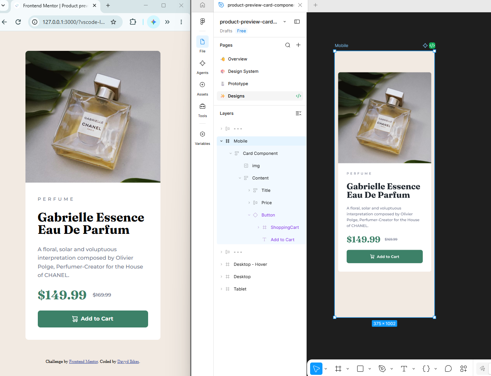

# Frontend Mentor - Product preview card component solution

This is a solution to the [Product preview card component challenge on Frontend Mentor](https://www.frontendmentor.io/challenges/product-preview-card-component-GO7UmttRfa). Frontend Mentor challenges help you improve your coding skills by building realistic projects.

## Table of contents

- [Overview](#overview)
    - [The challenge](#the-challenge)
    - [Screenshot](#screenshot)
    - [Links](#links)
- [My process](#my-process)
    - [Built with](#built-with)
    - [What I learned](#what-i-learned)
    - [Useful resources](#useful-resources)
    - [AI Collaboration](#ai-collaboration)
- [Author](#author)
- [Acknowledgments](#acknowledgments)

## Overview

### The challenge

Users should be able to:

- View the optimal layout depending on their device's screen size
- See hover and focus states for interactive elements

From my side:

- Added usage of SCSS for writing more generic code
- Following mobile first layout

### Screenshot

Process of the preparation of mobile layout:



### Links

- Live Site URL: [GitHub Pages](https://davydikkes.github.io/fm-product-preview-card/)

## My process

### Built with

- Semantic HTML5 markup
- CSS custom properties
- Flexbox
- SASS
- Mobile-first workflow

### What I learned


Usage of `picture` element for several images depending on screen size:
```html
<picture>
    <source
        srcset="images/image-product-desktop.jpg"
        media="(width >= 768px)"
    />
    
</picture>
```

Use case of inheritance:

```scss
%text-preset-1 {
    font-family: var(--font-family-fraunces);
    font-size: 2rem;
    line-height: 100%;
    font-weight: 700;
}
```

### Useful resources

- [Picture Element MDN](https://developer.mozilla.org/en-US/docs/Web/HTML/Reference/Elements/picture) - This helped me to understand how to use `picture` element into DOM for using several pictures depends on sizes of the screen.
- [SASS inheritance](https://sass-lang.com/guide/#extend-inheritance) - This documentation help me to prepare sets of fonts for further usage in my SASS code.

### AI Collaboration

GitHub Copilot helps me to solve some tricky questions and bugs that I had during the process of markup preparation and adding the styles. I don't use inline suggestions, only ask how to solve this.

Helpful shortcut: `Ctrl+Alt+I` into VS Code

## Author

- Frontend Mentor - [@DavydIkkes](https://www.frontendmentor.io/profile/DavydIkkes)
